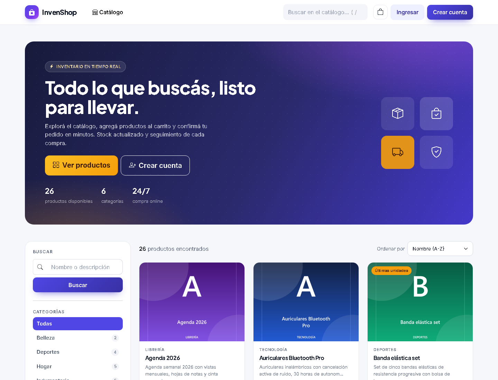
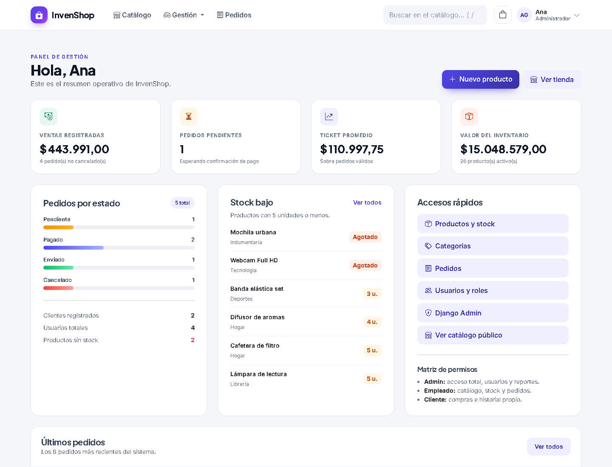

# InvenShop

Sistema de **gestión de inventario y comercio electrónico** desarrollado con Django para la materia **Programación IV (2026)** de la Tecnicatura Superior en Desarrollo de Software.

Incluye catálogo público, carrito en sesión, checkout con datos de envío, historial de pedidos con control de estados, panel de gestión con métricas, administración de usuarios por roles y un Django Admin completamente personalizado.

---

## 1. Funcionalidades

### Catálogo público
- Listado de productos activos con **paginación de 12 por página**.
- Búsqueda por nombre y descripción.
- Filtro por categoría y orden por nombre, precio o fecha de creación.
- Ficha de producto con selector de cantidad, stock disponible e indicador **Agotado**.
- Los productos agotados o inactivos no se pueden agregar al carrito.
- Diseño responsive con Bootstrap 5, iconografía y tipografías propias.

### Carrito y checkout
- Carrito almacenado en la **sesión de Django** (funciona incluso sin iniciar sesión).
- Agregar, actualizar, quitar y vaciar productos.
- Validación de stock al agregar, actualizar y confirmar la compra.
- Subtotal por ítem, total general y aviso cuando el stock cambió.
- Checkout exclusivo para usuarios autenticados.
- Datos de envío con validación propia: dirección, ciudad, código postal, teléfono de contacto y notas.
- Confirmación final con resumen del pedido.
- Creación **atómica** del pedido, sus detalles y descuento de stock.
- El carrito se vacía al confirmar la compra.

### Pedidos
- Estados: **Pendiente → Pagado → Enviado**, con cancelación desde Pendiente o Pagado.
- Solo Administradores y Empleados pueden cambiar el estado.
- Al cancelar se **repone automáticamente el stock** (una sola vez).
- Los clientes solo ven sus propios pedidos; el acceso a un pedido ajeno devuelve 404.
- Se guarda una copia del precio unitario y de los datos de envío para conservar el histórico.

### Roles y permisos
| Rol | Alcance |
| --- | --- |
| **Administrador** | Acceso total: panel, reportes, catálogo, pedidos, usuarios y roles, Django Admin. |
| **Empleado** | Panel, catálogo, categorías, stock y cambios de estado de pedidos. No gestiona usuarios. |
| **Cliente** | Catálogo, carrito, checkout, historial y perfil propio. |

- Registro público: toda cuenta nueva recibe el rol **Cliente**.
- Login por **email** (no existe `username`).
- Redirección posterior al login: clientes → catálogo; staff → panel de gestión.
- Un usuario autenticado sin permisos recibe una página **403** personalizada.

### Panel y Django Admin
- Panel con ventas, pedidos por estado, ticket promedio, valor del inventario, productos con stock bajo, clientes y últimos pedidos.
- Django Admin con `search_fields`, `list_filter`, `list_display`, `list_editable` (`stock` y `activo`), jerarquía por fecha y filtros.
- Detalle de pedido en el admin como **inline de solo lectura**, sin alta ni borrado de líneas.
- Acciones masivas para marcar pedidos como Pagado/Enviado o cancelarlos reponiendo stock.
- Validación de transiciones de estado también desde el admin.

---

## 2. Tecnologías

- Python 3.13
- Django 5.2.19 LTS
- SQLite (por defecto) o PostgreSQL
- HTML5, CSS3, Bootstrap 5.3, Bootstrap Icons, JavaScript
- Django Templates con herencia y filtros personalizados
- Pillow (imágenes de demostración)
- python-dotenv (variables de entorno)

---

## 3. Estructura del proyecto

```text
TPA/
├── config/                 # Configuración, rutas raíz, WSGI/ASGI
├── usuarios/               # Usuario personalizado, login, roles, perfil
├── catalogo/               # Categorías, productos, catálogo y gestión
├── pedidos/                # Carrito, checkout, pedidos y estados
├── panel/                  # Dashboard, reportes y páginas de error
│   └── management/commands/seed_demo.py
├── templates/              # Templates organizados por app y partials
├── static/                 # CSS, JavaScript e imágenes del sitio
├── media/                  # Imágenes subidas/generadas (no versionado)
├── docs/                   # Documentación adicional
├── manage.py
├── requirements.txt
├── .env.example
└── README.md
```

Cada app mantiene su propio `models.py`, `views.py`, `forms.py`, `urls.py`, `admin.py`, `migrations/` y `tests.py`.

---

## 4. Puesta en marcha

### Requisitos
- Python 3.11 o superior (probado con 3.13).
- Git (opcional).

### Windows (PowerShell)

```powershell
# 1. Crear y activar el entorno virtual
python -m venv venv
.\venv\Scripts\Activate.ps1

# 2. Instalar dependencias
python -m pip install --upgrade pip
pip install -r requirements.txt

# 3. Crear el archivo de entorno
Copy-Item .env.example .env
# Editar .env y definir DJANGO_SECRET_KEY

# 4. Migrar la base de datos
python manage.py migrate

# 5. Cargar datos de demostración (categorías, productos, usuarios y pedidos)
python manage.py seed_demo

# 6. Ejecutar el servidor
python manage.py runserver
```

### Linux / macOS

```bash
python3 -m venv venv
source venv/bin/activate
pip install -r requirements.txt
cp .env.example .env
python manage.py migrate
python manage.py seed_demo
python manage.py runserver
```

Abrir <http://127.0.0.1:8000/>.

> `seed_demo` es idempotente: se puede ejecutar más de una vez sin duplicar datos.
> Genera las imágenes de los productos con Pillow. Para omitirlas: `python manage.py seed_demo --sin-imagenes`.

### Variables de entorno principales

| Variable | Descripción | Valor por defecto |
| --- | --- | --- |
| `DJANGO_SECRET_KEY` | Clave secreta de Django | clave insegura de desarrollo |
| `DJANGO_DEBUG` | Modo debug | `True` |
| `DJANGO_ALLOWED_HOSTS` | Hosts permitidos, separados por coma | `127.0.0.1,localhost` |
| `DB_ENGINE` | `sqlite` o `postgres` | `sqlite` |
| `DB_NAME` | Nombre de la base / archivo SQLite | `db.sqlite3` |
| `DB_USER`, `DB_PASSWORD`, `DB_HOST`, `DB_PORT` | Conexión PostgreSQL | — |

Para generar una clave segura:

```bash
python -c "from django.core.management.utils import get_random_secret_key; print(get_random_secret_key())"
```

### PostgreSQL (opcional)

1. Crear la base y el usuario.
2. En `.env` establecer `DB_ENGINE=postgres` y completar `DB_*`.
3. Ejecutar `python manage.py migrate` y `python manage.py seed_demo`.

---

## 5. Usuarios de demostración

| Rol | Email | Contraseña |
| --- | --- | --- |
| Administrador | `admin@invenshop.com` | `Admin1234!` |
| Empleado | `empleado@invenshop.com` | `Empleado1234!` |
| Cliente | `cliente@invenshop.com` | `Cliente1234!` |
| Cliente | `lucia@invenshop.com` | `Cliente1234!` |

> Las credenciales son solo para la demostración académica. Cambiarlas antes de publicar el proyecto.

El comando también crea 6 categorías, 26 productos y 5 pedidos de ejemplo en distintos estados.

Para crear un superusuario adicional:

```bash
python manage.py createsuperuser
```

---

## 6. Rutas principales

| Ruta | Descripción |
| --- | --- |
| `/` | Redirige al catálogo |
| `/catalogo/` | Catálogo con búsqueda, filtro, orden y paginación |
| `/catalogo/producto/<id>/` | Detalle del producto |
| `/carrito/` | Carrito de compras |
| `/pedidos/checkout/` | Checkout (requiere login) |
| `/pedidos/` | Historial de pedidos (propios o todos, según rol) |
| `/pedidos/<id>/` | Detalle del pedido |
| `/pedidos/<id>/estado/` | Cambio de estado (solo staff) |
| `/panel/` | Dashboard de gestión (solo staff) |
| `/cuenta/registro/` | Registro público |
| `/cuenta/login/` | Login por email |
| `/cuenta/perfil/` | Perfil propio |
| `/cuenta/gestion/` | Usuarios y roles (solo Administrador) |
| `/catalogo/gestion/` | Productos y stock (staff) |
| `/catalogo/categorias/` | Categorías (staff) |
| `/admin/` | Django Admin personalizado |

---

## 7. Pruebas automatizadas

```bash
python manage.py test
```

Resultado actual: **68 pruebas OK** (usuarios, catálogo, carrito, checkout, pedidos, panel, admin, errores y comando de datos demo).

Cobertura funcional incluida:

- Registro, login por email, redirección por rol y cuentas inactivas.
- Permisos por rol y páginas 403/404 personalizadas.
- Búsqueda, filtros, orden, paginación y productos inactivos.
- Validación de stock y operaciones del carrito.
- Checkout atómico, precios congelados, validaciones de envío y carrito vaciado.
- Seguridad a nivel de objeto en pedidos.
- Transiciones de estado y reposición de stock al cancelar.
- Métricas del dashboard.
- Pantallas del Django Admin y detalle histórico de solo lectura.
- Idempotencia de `seed_demo`.

Para ejecutar una app en particular:

```bash
python manage.py test pedidos
python manage.py test catalogo
python manage.py test usuarios
python manage.py test panel
```

---

## 8. Decisiones de diseño

- **Usuario personalizado antes de la primera migración**, con email como identificador y sin `username`.
- **Rol en el modelo de usuario** y mixins reutilizables (`GestorMixin`, `AdminMixin`) para autorización.
- **Carrito en sesión**, tal como pide la consigna, sin modelo adicional.
- **Snapshot de precios y envío** en `Pedido`/`DetallePedido` para que el histórico no cambie si se edita el catálogo.
- **`PROTECT`** en las relaciones con usuarios y productos para evitar borrados que rompan pedidos.
- **Transacciones atómicas** (`transaction.atomic`) y `select_for_update` al crear pedidos y descontar stock.
- **Consultas optimizadas** con `select_related`/`prefetch_related` en catálogo, pedidos, panel y admin.
- **Django Admin** como segunda interfaz de gestión, con edición rápida de stock y acciones masivas.
- **Mensajes de feedback** con el framework de mensajes mapeado a alertas de Bootstrap.
- **CSRF y XSS**: todos los formularios usan ``, las plantillas escapan variables por defecto y no se usa `safe` con datos de usuario.

---

## 9. Correspondencia con la consigna

| Requisito | Implementación |
| --- | --- |
| Usuario personalizado y login por email | `usuarios/models.py`, `usuarios/forms.py`, `EmailAuthenticationForm` |
| Roles Admin / Empleado / Cliente | `Usuario.Rol`, mixins y vistas de gestión |
| Categoría 1:N Producto | `catalogo/models.py` |
| Usuario 1:N Pedido | `Pedido.usuario` (`PROTECT`) |
| Pedido 1:N DetallePedido | `DetallePedido.pedido` (`CASCADE`) |
| Producto 1:N DetallePedido | `DetallePedido.producto` (`PROTECT`) |
| Catálogo con búsqueda, filtro, orden y 12 por página | `ProductoListView` |
| Carrito en sesión con validación de stock | `pedidos/carrito.py` |
| Checkout con datos de envío y confirmación | `CheckoutView`, `CheckoutForm`, `crear_pedido` |
| Estados y cancelación con reposición de stock | `pedidos/services.py` |
| Seguridad a nivel de objeto | `PedidoListView` / `PedidoDetailView` |
| Panel con reportes | `panel/views.py` |
| Admin personalizado | `usuarios/admin.py`, `catalogo/admin.py`, `pedidos/admin.py` |
| Vistas basadas en clases | `ListView`, `DetailView`, `CreateView`, `UpdateView`, `DeleteView`, `FormView`, `TemplateView` |
| Herencia de templates y partials | `templates/base.html`, `templates/partials/` |
| Evitar N+1 | `select_related`, `prefetch_related`, `annotate` |
| Formularios con validaciones | `forms.py` de cada app |
| CSRF / XSS | Tokens CSRF y escape automático de templates |

---

## 10. Capturas

Las capturas de la aplicación están en [`docs/capturas/`](docs/capturas/):

| Archivo | Pantalla |
| --- | --- |
| `01-catalogo.png` | Catálogo público con búsqueda, filtros y paginación |
| `02-producto-detalle.png` | Ficha de producto y selector de cantidad |
| `03-login.png` | Inicio de sesión por email |
| `04-carrito.png` | Carrito con subtotales y total |
| `05-checkout.png` | Checkout con datos de envío |
| `06-confirmacion.png` | Confirmación del pedido |
| `07-mis-pedidos.png` | Historial del cliente |
| `08-panel-admin.png` | Panel de gestión con métricas |
| `09-gestion-usuarios.png` | Administración de usuarios y roles |
| `10-admin-productos.png` | Django Admin con edición rápida de stock |
| `11-admin-pedido.png` | Detalle histórico de solo lectura en el admin |
| `12-productos-empleado.png` | Gestión de productos para Empleado |
| `13-pedido-staff.png` | Detalle de pedido con acciones de estado |





---

## 11. Documentación adicional

- [`docs/EVALUACION.md`](docs/EVALUACION.md): checklist de la rúbrica y guion de demostración.
- `TPA_pdf/extracted.txt`: texto extraído de la consigna original.

---

## 12. Autor

Proyecto académico de **Programación IV · 2026**.
Tecnicatura Superior en Desarrollo de Software.
