# InvenShop — Guion de presentación y demostración

> **Materia:** Programación IV (ITSE 2026) · Tecnicatura Superior en Desarrollo de Software  
> **Proyecto:** InvenShop – Sistema de Gestión e Inventario con Comercio Electrónico  
> **Formato:** 14 "diapositivas" para proyectar o imprimir como PDF, con notas del orador y temporización para una demo de 10-15 minutos.  
> **Fuentes:** `README.md`, `docs/BITACORA.md`, `docs/EVALUACION.md`, `TPA_Requsisitos/` y `docs/capturas/`.

---

## Índice

| # | Diapositiva | Tiempo |
|---|---|---|
| 1 | Portada | 1 min |
| 2 | Problema y objetivo | 1 min |
| 3 | Arquitectura MVT y aplicaciones | 1 min |
| 4 | Modelo de datos | 30 s |
| 5 | Roles, permisos y seguridad | 30 s |
| 6 | Catálogo público | 2 min |
| 7 | Carrito y checkout | 1,5 min |
| 8 | Pedidos y estados | 1,5 min |
| 9 | Panel y reporte CSV | 1 min |
| 10 | Administración por roles y grupos | 1,5 min |
| 11 | Calidad del proyecto | 1 min |
| 12 | Bitácora de desarrollo | 1 min |
| 13 | Decisiones técnicas clave | 1 min |
| 14 | Cierre | 30 s |
| — | [Apéndice A: credenciales y comandos](#apéndice-a-credenciales-y-comandos) | — |
| — | [Apéndice B: matriz de requisitos](#apéndice-b-matriz-de-requisitos) | — |
| — | [Apéndice C: respuestas para la defensa](#apéndice-c-respuestas-para-la-defensa) | — |
| — | [Apéndice D: capturas disponibles](#apéndice-d-capturas-disponibles) | — |

---

# 1. Portada

## InvenShop

**Sistema de Gestión de Inventario y Comercio Electrónico**

Trabajo Final de Aplicación · Programación IV · 2026  
Tecnicatura Superior en Desarrollo de Software

**Django 5.2.19 LTS · Python 3.13 · MVT · SQLite/PostgreSQL**

> **Nota del orador (1 min):** Presentarse, nombrar el proyecto y decir que la exposición va a seguir el recorrido real de un cliente, un empleado y un administrador, con una demo en vivo de 10 a 15 minutos. Mencionar que todo el código, las capturas y la documentación están en el repositorio.

---

# 2. Problema y objetivo

## ¿Qué problema resuelve?

- Gestión de productos e inventario **descentralizada** o basada en planillas manuales en PyMEs.
- **Inconsistencias de stock**: ventas que no descuentan unidades o cancelaciones que no las reponen.
- **Retrasos** en la atención al cliente y falta de un catálogo consultable.

## Objetivo general

Aplicación web monolítica en Django que permita:

- Administrar productos y categorías.
- Gestionar el **inventario en tiempo real**.
- Procesar pedidos de forma **segura y atómica**.
- Ofrecer un **catálogo público** interactivo.

> **Nota del orador (1 min):** Leer el problema en una frase y pasar rápido al objetivo. Remarcar que el foco no es solo "vender", sino mantener el stock y el histórico de pedidos confiables. Decir: "Lo que sigue es cómo se resolvió cada una de esas necesidades".

---

# 3. Arquitectura MVT y aplicaciones

```text
Navegador
   │ HttpRequest
   ▼
config/urls.py ──include()──▶ usuarios/ · catalogo/ · pedidos/ · panel/
   ▼
Vistas (CBV + 1 FBV para el CSV)
   │  Mixins / decoradores → autorización por rol
   ▼
Modelos + ORM  (services.py concentra las reglas de negocio)
   │  select_related / prefetch_related / transacciones
   ▼
Base de datos (SQLite / PostgreSQL)
   ▼
Plantillas DTL (base.html + bloques + partials)
   ▼
HttpResponse (HTML o CSV)
```

| App | Responsabilidad |
|---|---|
| `usuarios` | Usuario personalizado, login por email, roles, grupos y permisos |
| `catalogo` | Categorías, productos, listado público y gestión de stock |
| `pedidos` | Carrito en sesión, checkout, estados y consultas |
| `panel` | Dashboard, reporte CSV, datos demo y páginas de error |

- Separación estricta: modelos = datos, `services.py` = reglas de negocio, vistas = orquestación, plantillas = presentación.

> **Nota del orador (1 min):** Señalar que es un monolito MVT, sin API externa ni servidores separados. Mostrar el esquema de capas de arriba abajo y decir que las tres apps obligatorias son `usuarios`, `catalogo` y `pedidos`, y que `panel` se agregó para las métricas y el CSV.

---

# 4. Modelo de datos

```text
Usuario (email = login, rol) ──1:N──▶ Pedido ──1:N──▶ DetallePedido ◀──N:1── Producto
                                                            │
Categoria ──1:N──▶ Producto ──────────────────────────────────┘
```

| Modelo | Puntos clave |
|---|---|
| `Usuario` | `email` único como `USERNAME_FIELD`, `nombre`, `apellido`, `rol`, `telefono` |
| `Categoria` / `Producto` | `PROTECT` en la FK; precio > 0, stock ≥ 0, `activo`, índices |
| `Pedido` | Datos de envío copiados, `total`, `estado`, número visible `#000001` |
| `DetallePedido` | `precio_unitario` congelado, unicidad por `(pedido, producto)` |

- `PROTECT` impide borrar registros con histórico; `CASCADE` solo al borrar un pedido.
- `snapshot` de precios y envío: el histórico no cambia si se edita el catálogo.

> **Nota del orador (30 s):** Recorrer el diagrama de izquierda a derecha. Destacar dos decisiones: no existe `username` (se ingresa con email) y el precio se guarda en cada detalle para que una modificación posterior del producto no altere pedidos anteriores.

---

# 5. Roles, permisos y seguridad

| Recurso | Anónimo | Cliente | Empleado | Admin |
|---|---|---|---|---|
| Catálogo y carrito | ✅ | ✅ | ✅ | ✅ |
| Checkout e historial propio | ❌ | ✅ | ✅ | ✅ |
| Panel y CSV | ❌ | ❌ | ✅ | ✅ |
| CRUD de productos y estados | ❌ | ❌ | ✅ | ✅ |
| Gestión de usuarios y roles | ❌ | ❌ | ❌ | ✅ |
| Django Admin | ❌ | ❌ | Catálogo y Pedidos | Todo |

- `PermisosPorRolBackend` traduce el rol a permisos de Django.
- Los `Group` (`Administradores`, `Empleados`, `Clientes`) se sincronizan por migración + señales.
- CBVs con mixins; FBV con `@login_required` + `@permission_required`.
- CSRF en todos los POST, escape automático en DTL, secretos en `.env`.

> **Nota del orador (30 s):** No leer toda la tabla: señalar las tres columnas de roles y decir la regla general: "cliente compra, empleado gestiona, admin gestiona también usuarios". Mencionar que un autenticado sin permiso recibe 403 y un anónimo va al login.

---

# 6. Catálogo público

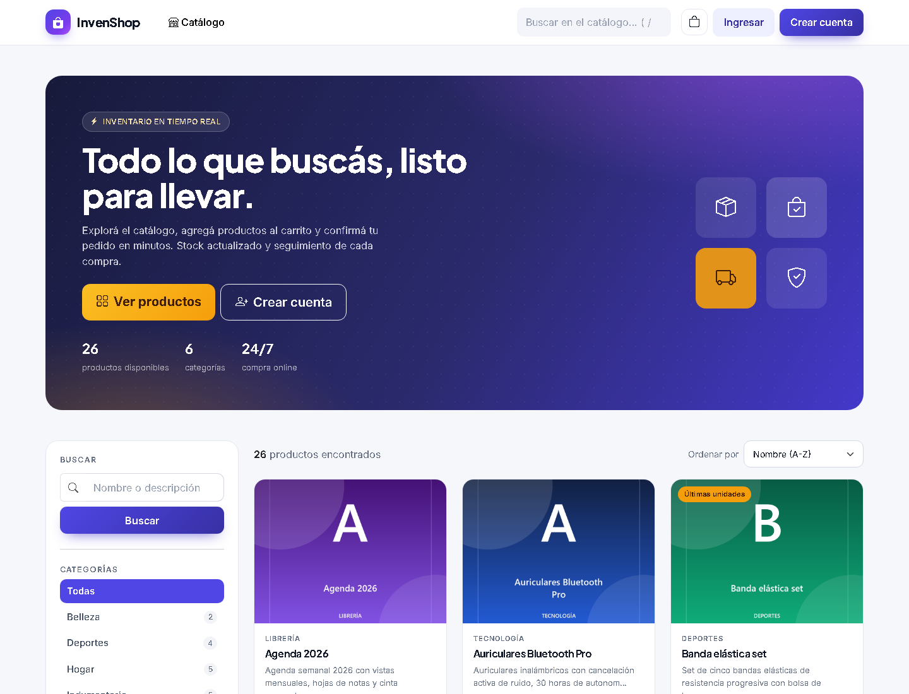

- 12 productos por página con paginación.
- Búsqueda por nombre y descripción con objetos `Q`.
- Filtro por categoría y orden por nombre, precio o fecha.
- `select_related("categoria")` para evitar consultas N+1.
- Solo productos **activos**; `Agotado` cuando `stock = 0` y sin botón de compra.

> **Nota del orador (2 min):** Abrir `/catalogo/`. Buscar "auriculares", elegir categoría Tecnología y ordenar por menor precio. Ir a la página 2 para mostrar la paginación. Abrir un producto con stock y mostrar el selector de cantidad. Abrir **Webcam Full HD** para mostrar el badge *Agotado* y que no se puede agregar.

---

# 7. Carrito y checkout

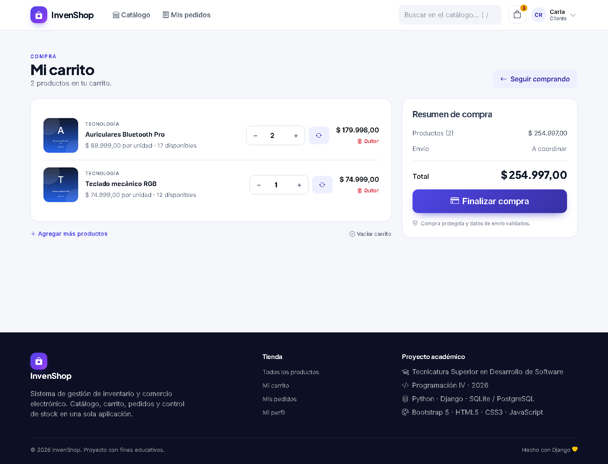 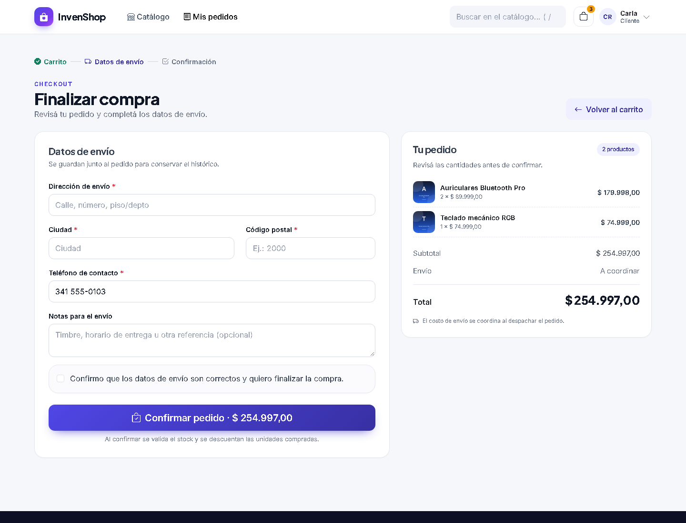 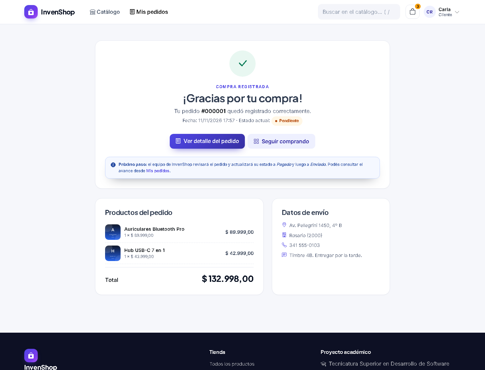

- Carrito en `request.session["carrito"]`, funciona sin iniciar sesión.
- Agregar, actualizar, quitar y vaciar; validación de stock en cada operación.
- Checkout con login obligatorio y datos de envío validados.
- `crear_pedido()`: `transaction.atomic()` + `select_for_update()` + descuento con `F("stock")`.
- El carrito se vacía al confirmar.

> **Nota del orador (1,5 min):** Agregar un producto como visitante y abrir `/carrito/` para ver que persiste. Mostrar que al querer finalizar se pide login. Ingresar como `cliente@invenshop.com`, superar el stock para ver el mensaje, completar el formulario y mostrar la confirmación con el carrito vacío.

---

# 8. Pedidos y estados

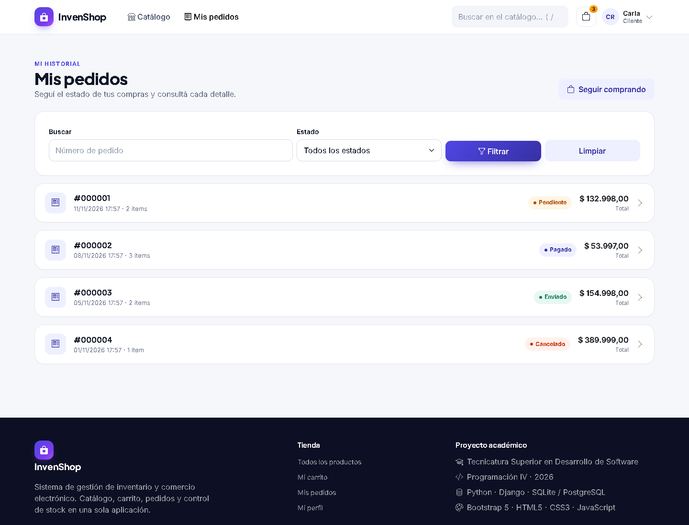 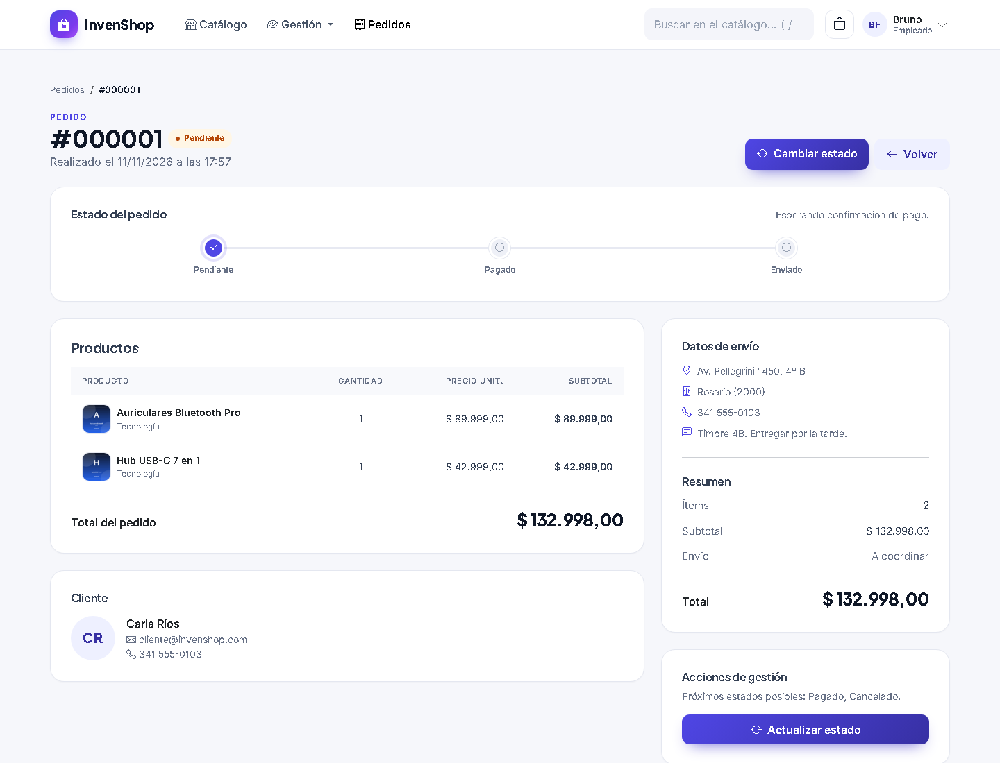

- Transiciones: **Pendiente → Pagado → Enviado**; cancelación desde Pendiente o Pagado.
- Solo Empleados y Administradores cambian estados.
- Al cancelar, el stock se repone una sola vez con `F("stock") + cantidad`.
- Los clientes ven solo sus pedidos; un pedido ajeno devuelve **404**.
- Número visible `#000001` y búsqueda por número en el listado y en el admin.

> **Nota del orador (1,5 min):** Mostrar "Mis pedidos" con el cliente y luego abrir `/pedidos/5/` para demostrar el 404 de un pedido ajeno. Cambiar de usuario a `empleado@invenshop.com`, pasar un pedido de Pendiente a Pagado y a Enviado, y cancelar otro para verificar la reposición de stock.

---

# 9. Panel y reporte CSV

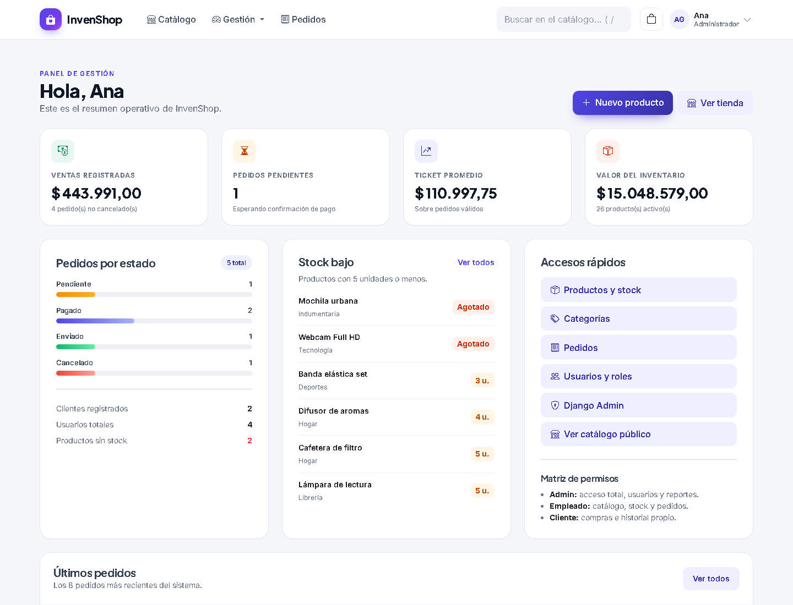

- Dashboard con ventas, pedidos por estado, ticket promedio, valor del inventario, stock bajo y últimos pedidos.
- `/panel/pedidos.csv`: vista de función con `@login_required` + `@permission_required`.
- Respeta los mismos filtros de estado y búsqueda del listado.
- Protección contra inyección de fórmulas de Excel y BOM UTF-8.

> **Nota del orador (1 min):** Ingresar como empleado para mostrar que la redirección posterior al login lleva al panel. Recorrer las métricas y descargar el CSV; abrirlo para mostrar que incluye los filtros aplicados. Recordar que un cliente que intente descargarlo recibe 403.

---

# 10. Administración por roles y grupos

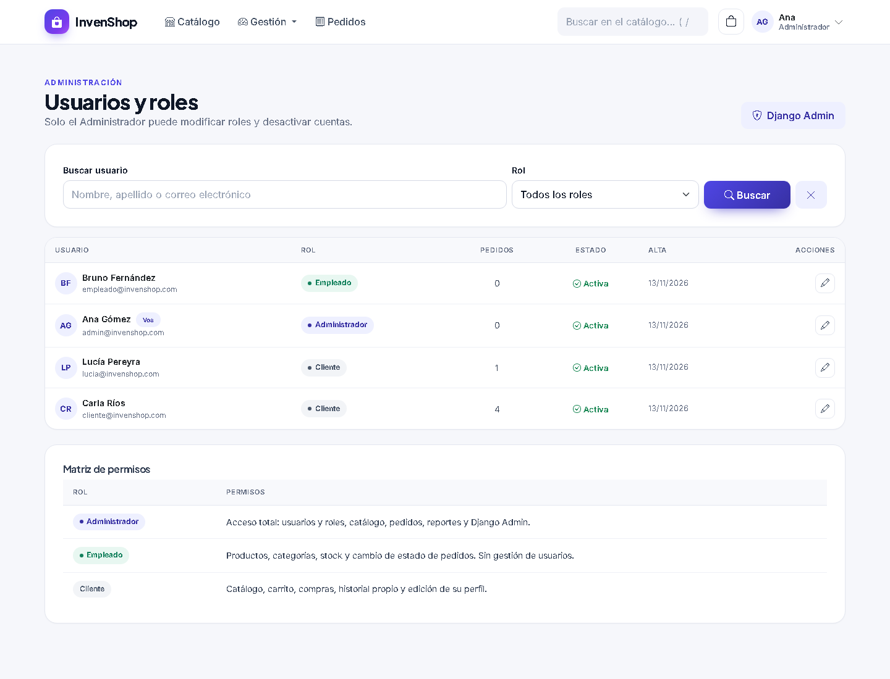 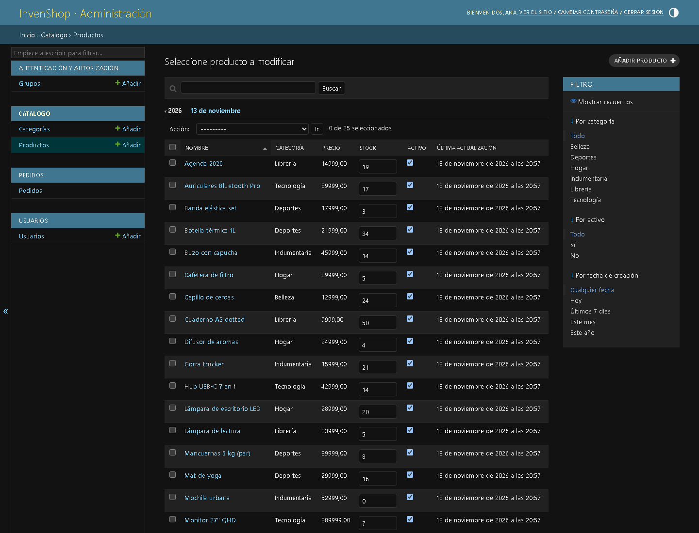 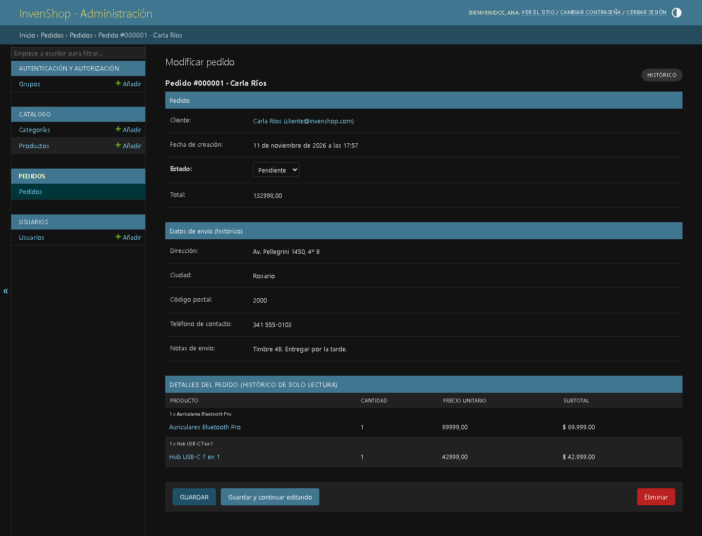 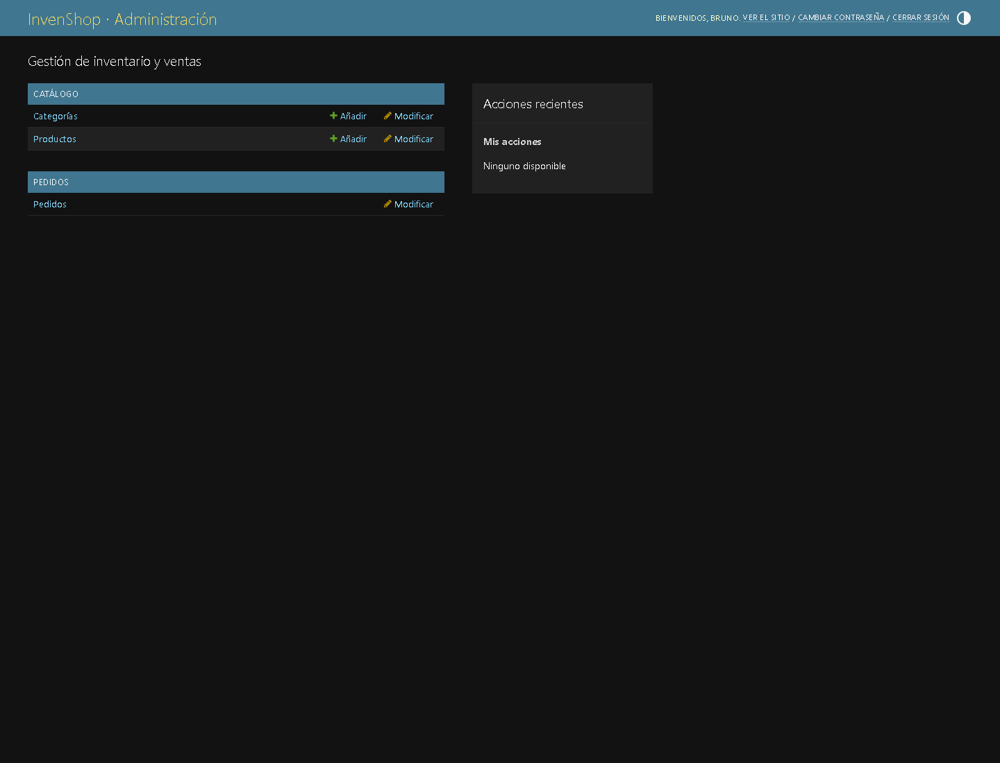

- **Admin:** `search_fields`, `list_filter`, `date_hierarchy`, `list_editable` de `stock` y `activo`.
- Detalle de pedido como **inline de solo lectura**; acciones masivas de estado.
- Usuario Admin sin `username`; grupos y permisos sincronizados con el rol.
- El Empleado ve solo Catálogo y Pedidos en `/admin/`.

> **Nota del orador (1,5 min):** Como administrador, abrir `/cuenta/gestion/` y cambiar el rol de un cliente a Empleado. Mostrar que no se puede quitar el propio rol. En `/admin/`, recorrer Productos con edición rápida de stock y Pedidos con el inline histórico; ejecutar una acción masiva. Volver al empleado para mostrar que su admin solo tiene Catálogo y Pedidos.

---

# 11. Calidad del proyecto

| Indicador | Resultado |
|---|---|
| Pruebas automatizadas | **83 tests OK** (18 usuarios, 13 catálogo, 29 pedidos, 19 panel) |
| Migraciones | 6 archivos; `makemigrations --check --dry-run` → *No changes detected* |
| ORM | `select_related`, `prefetch_related`, `annotate` en listados y panel |
| Datos demo | `seed_demo` idempotente: 6 categorías, 26 productos, 4 usuarios, 5 pedidos |
| Seguridad | CSRF, XSS evitado, secretos en `.env`, redirecciones seguras |

> **Nota del orador (1 min):** Ejecutar `python manage.py test` en vivo si hay tiempo y mostrar el resultado. Si no, decir el número y explicar que las pruebas cubren checkout atómico, estados, permisos, CSV y datos demo. Mencionar que no hay cambios de migración pendientes.

---

# 12. Bitácora de desarrollo

| Fecha | Commit | Hito |
|---|---|---|
| 2026-11-13 | `e482608` | `v0.1` — primera versión funcional |
| 2026-11-15 | `525e2ef` | Paginación, histórico del admin y capturas |
| 2026-11-15 | `94880e7` | Permisos por rol y búsqueda por número de pedido |
| 2026-11-15 | `28141e9` | Decoradores en FBV y reporte CSV |
| 2026-11-18 | `2be60ef` | Documentación actualizada |
| 2026-11-18 | `823892a` | Grupos de Django sincronizados con el rol |

> **Nota del orador (1 min):** Mostrar la evolución cronológica en 6 hitos. Destacar el último: la migración `usuarios.0003` crea los grupos y las señales `post_migrate`/`post_save` mantienen permisos y usuarios alineados; con eso el total de pruebas pasó de 79 a 83.

---

# 13. Decisiones técnicas clave

| Decisión | Razón |
|---|---|
| Carrito en sesión | Lo pide la consigna y permite comprar sin registro; se valida contra la BD al confirmar |
| Usuario personalizado antes de la primera migración | `email` como identificador y sin `username` |
| `rol` + `Group` de Django | El rol manda en la app; los grupos permiten gestionar permisos en bloque en el admin |
| `transaction.atomic` + `select_for_update` | Evita stock negativo si dos compras simultáneas compiten |
| Precio y envío copiados en el pedido | Conserva el histórico aunque cambie el catálogo |
| `PROTECT` en usuario y producto | No se puede borrar un cliente con pedidos ni un producto con ventas |
| `Clientes` sin permisos de modelo | Dar `view_pedido` abriría el admin; la privacidad se resuelve filtrando el queryset |
| Sin DRF | Es opcional en la rúbrica; se eligió MVT/DTL por ser la opción recomendada |

> **Nota del orador (1 min):** Elegir dos o tres de estas filas según las preguntas que ya hayan surgido. La más probable: por qué hay roles y grupos a la vez, y cómo se evita el stock negativo.

---

# 14. Cierre

## Estado final

- **16 requisitos** de la auditoría: cubiertos o con decisión tomada.
- **83 pruebas** en verde, documentación y capturas actualizadas.
- Demo reproducible con `python manage.py seed_demo`.

## Limitaciones (académicas, esperables)

- Pago simulado: el estado *Pagado* lo marca el personal.
- No hay cálculo automático de costo de envío ni recuperación de contraseña por email en la interfaz.
- Para producción: `DEBUG=False`, clave propia, HTTPS, `ALLOWED_HOSTS` reales y PostgreSQL.

> **Nota del orador (30 s):** Cerrar diciendo que el proyecto está funcionalmente completo y que las limitaciones son decisiones de alcance académico, no fallas. Agradecer y abrir preguntas.

---

# Apéndice A: credenciales y comandos

## Usuarios de demostración

| Rol | Email | Contraseña |
|---|---|---|
| Administrador | `admin@invenshop.com` | `Admin1234!` |
| Empleado | `empleado@invenshop.com` | `Empleado1234!` |
| Cliente | `cliente@invenshop.com` | `Cliente1234!` |
| Cliente | `lucia@invenshop.com` | `Cliente1234!` |

> Credenciales solo para la demostración académica; cambiarlas antes de publicar.

## Puesta en marcha (Windows / PowerShell)

```powershell
.\venv\Scripts\Activate.ps1
python manage.py migrate
python manage.py seed_demo
python manage.py runserver
```

## Comandos útiles

```powershell
python manage.py test
python manage.py test pedidos
python manage.py makemigrations --check --dry-run
python manage.py seed_demo --sin-imagenes
python manage.py createsuperuser
```

**URL base:** <http://127.0.0.1:8000/>

---

# Apéndice B: matriz de requisitos

| ID | Requisito | Estado |
|---|---|---|
| REQ-01 | Arquitectura monolítica MVT | Validado |
| REQ-02 | Modularización en apps | Validado |
| REQ-03 | Custom User Model con email | Validado |
| REQ-04 | Permisos por roles | Validado |
| REQ-05 | Catálogo paginado (12), filtros y búsqueda | Validado |
| REQ-06 | Control de stock e inactivos | Validado |
| REQ-07 | Carrito en sesión | Validado |
| REQ-08 | Checkout atómico | Validado |
| REQ-09 | Estados y reposición de stock | Validado |
| REQ-10 | Optimización ORM (N+1) | Validado |
| REQ-11 | Admin personalizado | Validado |
| REQ-12 | Variables de entorno y CSRF | Validado |
| REQ-13 | Formularios estilizados y CBVs | Validado |
| REQ-14 | Opción DRF | No implementada: opcional, se eligió MVT/DTL |
| REQ-15 | Exención por Práctica Profesionalizante | Trámite normativo, ajeno al código |
| REQ-16 | Exposición oral 15-30 min en 5 bloques | En curso (este documento apoya la demo) |

Detalle completo en `TPA_Requsisitos/Auditoría InvenShop.md` y `docs/EVALUACION.md`.

---

# Apéndice C: respuestas para la defensa

1. **¿Por qué el carrito está en la sesión?**  
   La consigna lo pide y permite comprar sin registro. Se valida contra la base al confirmar, donde se descuenta el stock de forma atómica.

2. **¿Por qué roles y grupos de Django a la vez?**  
   El campo `rol` es la fuente de verdad y `PermisosPorRolBackend` resuelve la autorización de la tienda. Los grupos `Administradores`, `Empleados` y `Clientes` cumplen la recomendación de gestionar permisos en bloque: los crea la migración `0003`, `post_migrate` les asigna permisos y `post_save` alinea al usuario cuando cambia el rol. `Clientes` no tiene permisos de modelo a propósito: darle `view_pedido` le abriría el admin; su privacidad se resuelve filtrando el queryset.

3. **¿Cómo se evita stock negativo con compras simultáneas?**  
   `crear_pedido()` abre una transacción, bloquea los productos con `select_for_update()`, valida el stock y recién entonces crea el pedido y descuenta con `F("stock") - cantidad`.

4. **¿Por qué se guarda el precio en `DetallePedido`?**  
   Para conservar el histórico: si el producto cambia de precio o se elimina, el pedido mantiene el valor original. Lo mismo aplica a los datos de envío.

5. **¿Cómo se protege el acceso a pedidos ajenos?**  
   El queryset se filtra por `usuario=request.user` para clientes y el detalle devuelve 404 si el pedido no pertenece al usuario autenticado.

6. **¿Por qué `PROTECT` en usuario y producto?**  
   Para impedir borrar un cliente con pedidos o un producto con ventas, preservando la integridad histórica.

7. **¿Cómo se evita el doble descuento o reposición de stock?**  
   El cambio de estado valida la transición y, si el pedido ya está en el estado destino, no hace nada. La cancelación repone stock solo la primera vez que pasa a *Cancelado*.

8. **¿Qué consultas se optimizaron?**  
   Catálogo con `select_related("categoria")`, pedidos con `select_related("usuario")` y `prefetch_related("detalles")`, y dashboard/admin con agregados y `annotate`.

---

# Apéndice D: capturas disponibles

| Archivo | Pantalla |
|---|---|
| `01-catalogo.png` | Catálogo público con búsqueda, filtros y paginación |
| `02-producto-detalle.png` | Ficha de producto y selector de cantidad |
| `03-login.png` | Inicio de sesión por email |
| `04-carrito.png` | Carrito con subtotales y total |
| `05-checkout.png` | Checkout con datos de envío |
| `06-confirmacion.png` | Confirmación del pedido |
| `07-mis-pedidos.png` | Historial del cliente |
| `08-panel-admin.png` | Panel de gestión con métricas |
| `09-gestion-usuarios.png` | Administración de usuarios y roles |
| `10-admin-productos.png` | Django Admin con edición rápida de stock |
| `11-admin-pedido.png` | Detalle histórico de solo lectura en el admin |
| `12-productos-empleado.png` | Gestión de productos para Empleado |
| `13-pedido-staff.png` | Detalle de pedido con acciones de estado |
| `14-admin-empleado.png` | Django Admin del Empleado: solo Catálogo y Pedidos |

Todas en `docs/capturas/`. Para imprimir este documento como PDF: abrirlo en un visor Markdown y usar "Imprimir → Guardar como PDF", o exportarlo con GitHub/Pandoc.

---

*Documento generado a partir del código fuente, `README.md`, `docs/BITACORA.md`, `docs/EVALUACION.md` y `TPA_Requsisitos/`. Noviembre de 2026.*
